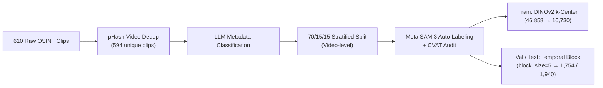

# Interceptor UAV Detection & Tracking System for Edge Devices

  <video src="https://github.com/user-attachments/assets/27a58b55-77d6-4a57-81fa-82197f6c5c2f" width="750" controls></video>

## Engineering Challenges & Overview

Edge UAV interception requires **CPU-only inference** because onboard GPUs add cost, weight, thermal throttling, and cooling overhead. Under high relative interceptor–target speeds, the detector must maintain **high FPS** without losing **small-target recall** or triggering **false background locks**: high-resolution full frames are too slow on CPU, while naive full-frame downscaling hides distant targets.

To address this trade-off for semi-autonomous tracking after operator target lock, I built a custom OSINT RGB/thermal UAV dataset (custom clip cutting, multi-stage deduplication, and labeling), trained **YOLO26n**, quantized it for CPU execution into **OpenVINO INT8** and **ONNX Runtime INT8**, and calibrated an **Adaptive ROI** cascade with **ByteTrack**. The scope focuses on data curation, model quantization, and tracking optimization rather than an autonomous autopilot or hardware-in-the-loop streaming pipeline.

---

## 1. Dataset Curation & Deduplication

- **Area-Weighted Two-Vector DINOv2 Deduplication ([`03`](notebooks/03_extract_embeddings.ipynb), [`04`](notebooks/04_embeddings_threshold_analysis.ipynb)):** Standard full-frame embeddings miss small distant UAV motion against static skies. For each frame, I extracted two `dinov2_vitb14` vectors — **global scene** (background) and **scale-adaptive target crop** — weighted dynamically by bbox area ratio (`area` vs `1 - area`) and concatenated into a single L2-normalized descriptor before greedy k-center cosine deduplication (`46,858 → 10,730` train frames, `-77.1%`).
- **Temporal Sampling & Hard Negatives ([`05`](notebooks/05_temporal_sampling_analysis.ipynb)):** `val` and `test` were subsampled via deterministic `block_size=5` temporal windows. Combat clips contain on-screen telemetry overlays (OSD) and unit watermarks, meaning a detector could **potentially learn OSD/watermark cues instead of UAV geometry** — so I added `1,118` pure-background negative frames containing clutter, horizons, and overlays.

  <table>
    <thead>
      <tr>
        <th align="left">Split</th>
        <th align="center">Positive Frames</th>
        <th align="center">Negative Frames</th>
        <th align="center">Total Curated Frames</th>
      </tr>
    </thead>
    <tbody>
      <tr>
        <td><code>train</code></td>
        <td align="center">9,763</td>
        <td align="center">967</td>
        <td align="center"><strong>10,730</strong></td>
      </tr>
      <tr>
        <td><code>val</code></td>
        <td align="center">1,680</td>
        <td align="center">74</td>
        <td align="center"><strong>1,754</strong></td>
      </tr>
      <tr>
        <td><code>test</code> (frozen)</td>
        <td align="center">1,863</td>
        <td align="center">77</td>
        <td align="center"><strong>1,940</strong></td>
      </tr>
      <tr>
        <td><strong>Total Active</strong></td>
        <td align="center"><strong>13,306</strong></td>
        <td align="center"><strong>1,118</strong></td>
        <td align="center"><strong>14,424</strong></td>
      </tr>
    </tbody>
  </table>

*Details: [`01_data_exploration.ipynb`](notebooks/01_data_exploration.ipynb), [`02_sam3_auto_labeling.ipynb`](notebooks/02_sam3_auto_labeling.ipynb), [`04_embeddings_threshold_analysis.ipynb`](notebooks/04_embeddings_threshold_analysis.ipynb).*

---

## 2. Shortcut Learning Audit (`YOLO26n`)

To test whether OSD overlays or brigade/charity watermarks induce shortcut learning, I trained two `YOLO26n` models ([`06_yolo_training.ipynb`](notebooks/06_yolo_training.ipynb)) — `positives_only` vs `with_negatives` — and compared their `val` metrics and paired EigenCAM saliency maps ([`07_yolo_evaluation_diagnostics.ipynb`](notebooks/07_yolo_evaluation_diagnostics.ipynb)):

  <table>
    <thead>
      <tr>
        <th align="left">Model Variant (<code>val</code>, 1,754 frames)</th>
        <th align="center">Precision</th>
        <th align="center">Recall</th>
        <th align="center">mAP@50</th>
        <th align="center">Negatives FP (@0.25)</th>
      </tr>
    </thead>
    <tbody>
      <tr>
        <td><code>positives_only</code></td>
        <td align="center">0.9415</td>
        <td align="center">0.9336</td>
        <td align="center">0.9593</td>
        <td align="center">39.19% (29/74)</td>
      </tr>
      <tr>
        <td><strong><code>with_negatives</code></strong></td>
        <td align="center"><strong>0.9526</strong></td>
        <td align="center"><strong>0.9375</strong></td>
        <td align="center"><strong>0.9617</strong></td>
        <td align="center"><strong>28.38% (21/74)</strong></td>
      </tr>
    </tbody>
  </table>

  

Both `val` metrics and EigenCAM saliency maps confirm no watermark shortcut learning on either model, while hard negatives visibly improve background rejection (`39.19% → 28.38%` FP on `val` empty scenes).

---

## 3. CPU Post-Training Quantization

I quantized `YOLO26n` (`with_negatives`) at `1280×1280` and `640×640` into **OpenVINO NNCF INT8** and **ONNX Runtime QDQ INT8** using `500` `train`-only frames stratified by target scale and negatives ([`08_model_quantization.ipynb`](notebooks/08_model_quantization.ipynb)).

  <table>
    <thead>
      <tr>
        <th align="center">imgsz</th>
        <th align="left">Quantized Format</th>
        <th align="center">Size</th>
        <th align="center">AP50 (val → test)</th>
        <th align="center">AP50_small (val → test)</th>
        <th align="center">Test Latency / FPS*</th>
      </tr>
    </thead>
    <tbody>
      <tr>
        <td align="center"><strong>1280</strong></td>
        <td><strong>OpenVINO NNCF INT8</strong></td>
        <td align="center"><strong>3.48 MB</strong></td>
        <td align="center"><strong>0.9499 → 0.8958</strong></td>
        <td align="center"><strong>0.9244 → 0.6992</strong></td>
        <td align="center">198.07 ms / <strong>5.05 FPS</strong></td>
      </tr>
      <tr>
        <td align="center"><strong>1280</strong></td>
        <td>ONNX Runtime QDQ INT8 <em>(MovingAvg + FP32 Head)</em></td>
        <td align="center">3.74 MB</td>
        <td align="center">0.9358 → 0.8908</td>
        <td align="center">0.9185 → 0.7066</td>
        <td align="center">311.09 ms / 3.21 FPS</td>
      </tr>
      <tr>
        <td align="center"><strong>640</strong></td>
        <td><strong>OpenVINO NNCF INT8</strong></td>
        <td align="center"><strong>3.19 MB</strong></td>
        <td align="center"><strong>0.7779 → 0.6354</strong></td>
        <td align="center"><strong>0.4626 → 0.1736</strong></td>
        <td align="center"><strong>29.88 ms / 33.47 FPS</strong></td>
      </tr>
      <tr>
        <td align="center"><strong>640</strong></td>
        <td>ONNX Runtime QDQ INT8 <em>(MovingAvg + FP32 Head)</em></td>
        <td align="center">3.26 MB</td>
        <td align="center">0.7522 → 0.6099</td>
        <td align="center">0.4536 → 0.1822</td>
        <td align="center">123.67 ms / 8.09 FPS</td>
      </tr>
    </tbody>
  </table>

- **Configuration Choice:** Standard ONNX `MinMax` calibration dropped detection quality (`val AP50 = 0.8978` at `1280`, `0.6931` at `640`); switching to `MovingAvg` calibration while keeping the Detect-head regression/classification layers in FP32 restored accuracy. **OpenVINO NNCF INT8** achieved the best size and accuracy retention (`-64.6%` / `-66.5%` disk reduction vs FP32), while **ONNX INT8** is maintained for cross-platform portability.
- **\*Throughput Caveat:** Sequential long-running local benchmarks across all stages triggered CPU thermal throttling on later runs (`640 OpenVINO INT8` reached `19.03 ms / 52.54 FPS` on `val` vs `29.88 ms / 33.47 FPS` on `test`), so reported FPS figures are relative CPU reference points rather than final edge-device guarantees.

---

## 4. Adaptive ROI & Tracker Selection

To avoid choosing between slow `1280` inference and low-recall `640` downscaling, I quantized the `1280`-trained model to `640` and built a two-state cascade ([`09_mot_analysis.ipynb`](notebooks/09_mot_analysis.ipynb)): **`SEARCH 1280`** locks the target (`seed_conf=0.25`), then **`TRACK 640`** runs on an unscaled `640×640` crop centered either on the last bbox (**`roi_static`**) or a Kalman velocity forecast (**`roi_kalman`**), falling back to `1280` after `3` missed frames.

  <table>
    <thead>
      <tr>
        <th align="left">Tracker Calibration (<code>val</code>, 84 seqs)</th>
        <th align="center">HOTA</th>
        <th align="center">IDF1</th>
        <th align="center">MOTA</th>
        <th align="center">IDSW</th>
      </tr>
    </thead>
    <tbody>
      <tr>
        <td><strong>ByteTrack</strong> <em>(selected)</em></td>
        <td align="center"><strong>76.56</strong></td>
        <td align="center"><strong>91.29</strong></td>
        <td align="center"><strong>89.82</strong></td>
        <td align="center"><strong>24</strong></td>
      </tr>
      <tr>
        <td>OC-SORT</td>
        <td align="center">75.82</td>
        <td align="center">84.32</td>
        <td align="center">83.92</td>
        <td align="center">38</td>
      </tr>
    </tbody>
  </table>

 

  <table>
    <thead>
      <tr>
        <th align="left">Final System (<code>test</code>, 84 seqs, ByteTrack)</th>
        <th align="center">HOTA</th>
        <th align="center">IDF1</th>
        <th align="center">MOTA</th>
        <th align="center">Small Recall</th>
        <th align="center">640 Share</th>
        <th align="center">FPS*</th>
      </tr>
    </thead>
    <tbody>
      <tr>
        <td><code>full_1280</code> <em>(ceiling)</em></td>
        <td align="center">70.73</td>
        <td align="center">83.95</td>
        <td align="center">82.61</td>
        <td align="center">61.38%</td>
        <td align="center">0.0%</td>
        <td align="center">5.82</td>
      </tr>
      <tr>
        <td><code>resize_640</code> <em>(solo 640)</em></td>
        <td align="center">49.37</td>
        <td align="center">63.55</td>
        <td align="center">48.03</td>
        <td align="center">6.92%</td>
        <td align="center">100.0%</td>
        <td align="center">11.62</td>
      </tr>
      <tr>
        <td><strong><code>roi_static</code> <em>(default)</em></strong></td>
        <td align="center"><strong>60.37</strong></td>
        <td align="center"><strong>76.45</strong></td>
        <td align="center"><strong>64.88</strong></td>
        <td align="center"><strong>45.97%</strong></td>
        <td align="center"><strong>81.5%</strong></td>
        <td align="center"><strong>14.51</strong></td>
      </tr>
      <tr>
        <td><code>roi_kalman</code> <em>(optional)</em></td>
        <td align="center">60.31</td>
        <td align="center">76.23</td>
        <td align="center">63.87</td>
        <td align="center">45.24%</td>
        <td align="center">81.5%</td>
        <td align="center">9.26</td>
      </tr>
    </tbody>
  </table>

- **`roi_static + ByteTrack`** executes **`81.5%`** of frames in `640×640` crop mode while lifting **`HOTA` by `+11.00`** and **`Small Recall` by `6.6×`** (`45.97%` vs `6.92%`) over standalone `resize_640`.
- **\*Throttling Limitation:** `roi_static` and `roi_kalman` deliver nearly identical accuracy and `640`-crop share (`81.5%`); multi-hour sequential benchmarking on the mobile `Intel Core i7-11370H` CPU caused thermal throttling on later runs, preventing an objective speed comparison between them.
