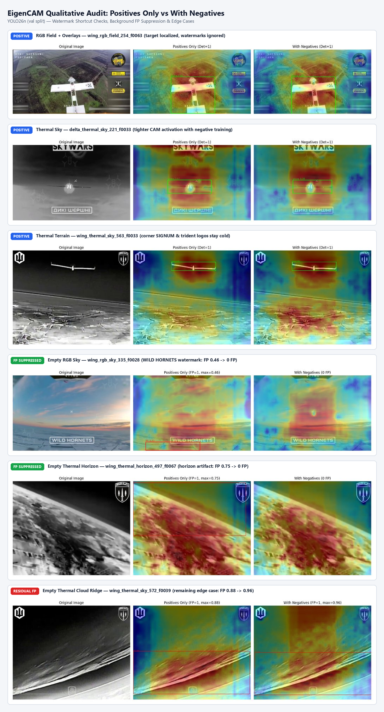
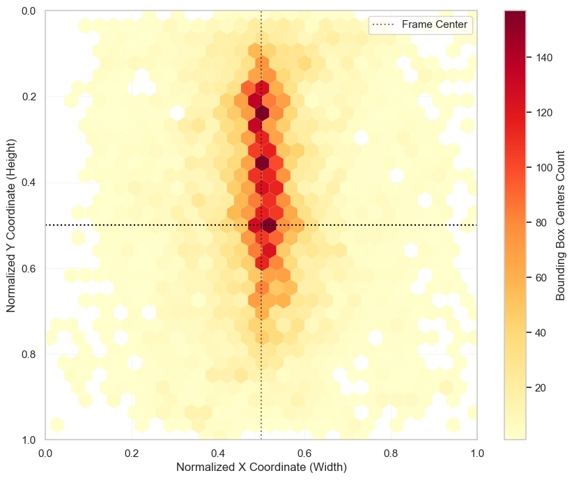

# Real-Time UAV Detection & Adaptive ROI Tracking (YOLO26n OpenVINO INT8)

  <video src="https://github.com/user-attachments/assets/531a8a64-148a-4106-9fde-620d44585e0f" width="750" controls></video>

---

## 🛠 Tech Stack

* **Detection & Compression:** PyTorch, Ultralytics YOLO26n, ONNX Runtime (QDQ INT8), OpenVINO + NNCF (INT8)
* **Adaptive Video Tracking:** Adaptive ROI (`SEARCH 1280` ↔ `TRACK 640`), Kalman Center Forecaster, BoxMOT (`ByteTrack`, `OC-SORT`), TrackEval
* **Dataset Engineering:** Meta SAM 3, DINOv2 (`k-Center Greedy`), OpenCV, CVAT, Hugging Face Hub
* **Deployment & UI:** Gradio (`app.py`), Hugging Face Spaces

---

## 📌 Project Overview

Latency-driven model and tracker selection for semi-autonomous UAV interception on CPU/edge hardware (`>= 30 FPS` real-time target budget). Global high-resolution `1280×1280` inference captures distant sub-`32×32 px` fixed-wing targets accurately, while steady-state tracking switches to unscaled `640×640` Kalman-predicted ROI crops around the target to reduce CPU compute without sacrificing pixel scale.

---

## 🧠 Core Architecture

* **Detection Model (`YOLO26n`):** Lightweight end-to-end NMS-free architecture (~2.5M parameters, `yolo26n_run_with_negatives_best.pt`) trained with negative frames to eliminate watermark/OSD shortcut learning.
* **CPU INT8 Quantization (Phase A):**
  * **Calibration:** 500 train-only scale-stratified frames (`seed=42`: `small=75`, `medium=95`, `large=275`, `negative=55`; zero `val`/`test` leakage).
  * **Primary Runtime (`OpenVINO INT8`):** NNCF mixed-precision PTQ executed directly via `OpenVINOYOLODetector` (`device_name="CPU"`, `PERFORMANCE_HINT="LATENCY"`).
  * **Cross-Platform ONNX INT8:** Custom `QDQ` static quantization (`reduce_range=False`, `CalibMovingAverage`) keeping the `/model.23/` Detect head in FP32 to preserve tracker-compatible confidence calibration (`tp_conf_median = 0.92–0.97`).
* **Dual-Resolution Adaptive ROI (Phase B):**
  * **`SEARCH 1280`:** Full-frame `1280×1280` `OpenVINO INT8` scan on acquisition or after `max_lost_frames` consecutive misses.
  * **`TRACK 640`:** Unscaled `640×640` `OpenVINO INT8` crop centered on the Kalman/tracker forecast + multi-object tracking (`ByteTrack` / `OC-SORT`).

---

## 📊 Dataset Engineering & Pipeline

* **Dataset Size:** 13,200 verified frames (12,000 positive, 1,200 negative) extracted from 69,529 raw frames.
* **Automated Curation (Human-in-the-Loop):**
  1. Automated metadata classification.
  2. Pseudo-annotations generated via **Meta SAM 3**.
  3. Manual CVAT refinement.
* **Deduplication:**
  1. **Spatial deduplication:** IoU-based filtering (removed 9,796 static frames).
  2. **Semantic deduplication:** **DINOv2** embeddings and *k-Center Greedy* sampling (removed 46,263 low-information frames).

### 🎯 Generalization & Shortcut Learning Mitigation
Negative samples eliminated watermark and OSD telemetry shortcuts ("Clever Hans" effect), shifting EigenCAM attention onto UAV airframes.

  

  

---

## 📈 Results

### 1. Detection Baseline (FP32 PyTorch `YOLO26n`)

| Metric | Validation Split | Test Split |
| :--- | :---: | :---: |
| **Precision** | 0.9279 | 0.8886 |
| **Recall** | 0.8426 | 0.8144 |
| **mAP@50** | 0.9094 | 0.8668 |
| **mAP@50-95** | 0.7021 | 0.6696 |

### 2. CPU Quantization Verification (`val` → frozen `test`, threshold-free `collection_conf=0.01`)

| `imgsz` | Variant | Size (MB) | `AP50` (val → test) | `Δ AP50 vs FP32` (val / test) | `AP50_small` (val → test) | Relative Compute Speedup vs own FP32 (val / test) |
| :---: | :--- | :---: | :---: | :---: | :---: | :---: |
| **1280** | `onnx_fp32` | 9.83 | 0.9508 → 0.9005 | baseline | 0.9132 → 0.6952 | 1.00× / 1.00× |
| **1280** | `onnx_int8` *(MovingAvg + FP32 Head)* | 3.74 | 0.9358 → 0.8908 | -0.0150 / -0.0097 | 0.9185 → 0.7066 | 0.75× / 0.62× |
| **1280** | `openvino_fp32` | 9.81 | 0.9523 → 0.8999 | baseline | 0.9175 → 0.6949 | 1.00× / 1.00× |
| **1280** | **`openvino_int8`** *(deployed)* | **3.48** | **0.9499 → 0.8958** | **-0.0025 / -0.0042** | **0.9244 → 0.6992** | **1.06× / 2.17×** *(1.73× vs PyTorch)* |
| **640** | `onnx_fp32` | 9.35 | 0.7578 → 0.6167 | baseline | 0.2564 → 0.1683 | 1.00× / 1.00× |
| **640** | `onnx_int8` *(MovingAvg + FP32 Head)* | 3.26 | 0.7522 → 0.6099 | -0.0056 / -0.0067 | 0.4536 → 0.1822 | 1.33× / 1.08× *(2.56× vs PyTorch)* |
| **640** | `openvino_fp32` | 9.52 | 0.7571 → 0.6161 | baseline | 0.2591 → 0.1690 | 1.00× / 1.00× |
| **640** | **`openvino_int8`** *(deployed)* | **3.19** | **0.7779 → 0.6354** | **+0.0207 / +0.0193** | **0.4626 → 0.1736** | **2.30× / 3.29×** *(5.61×–10.62× vs PyTorch)* |

*Note: Raw `test` `AP50_small` reflects a 2.7× higher share of small ground-truth targets (`142` vs `53` on `val`) already visible in FP32. Relative CPU compute speedups measure pure INT8 vs FP32 gains rather than a fixed target-device FPS guarantee.*

### 3. Adaptive ROI & MOT Video Ablation (`val` → `test`)
*Pending completion of `scripts/07_video_ablation.py --stage all` and `notebooks/09_mot_analysis.ipynb` (`full_1280` vs `resize_640` vs `roi_static` vs `roi_kalman` across `ByteTrack` and `OC-SORT`).*